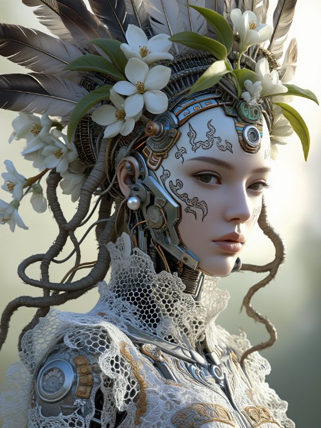
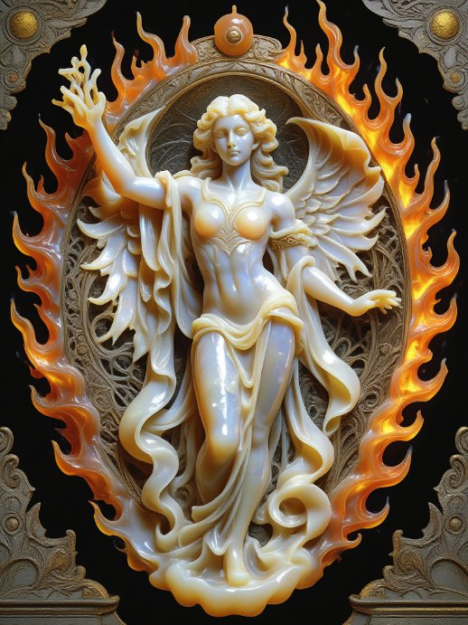
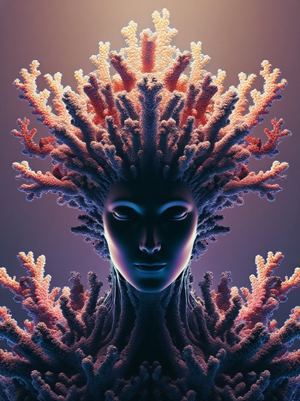

# Z-Image Base UI

## Content warning -- this model is unfiltered

Z-Image Base is an ungated, unfiltered foundation model. It renders whatever you prompt -- including adult / NSFW content if you ask for it. This app adds no prompt filtering and no output filtering. What you generate is your responsibility: follow your local laws, and adult content is for adults only. (Every example image in this README is safe for work.)

## Before you start

- A Windows PC. Python is included in this package (a bundled Python 3.12 in `python_embeded\`) — there is nothing to install first, and any Python you already have is left completely alone.
- An NVIDIA graphics card (12 GB is plenty), about 20 GB free disk space, and an internet connection.
- The first Generate downloads about 15 GB of model weights on the default quantized path (about 20 GB if you switch to full BF16).
- No token, no account, no license acceptance. Z-Image Base is Apache 2.0 and ungated — the first download just works.

**Z-Image Base, without Jupyter and without Colab.**

Z-Image Base is Tongyi-MAI's (Alibaba) 6B undistilled foundation image model — the full-strength sibling of Z-Image Turbo. Because Base is not distilled, it takes real classifier-free guidance: this UI has a guidance slider and a working negative prompt box, and it runs 28–50 steps instead of Turbo's locked 9 steps at guidance 0. If you want the fast distilled version, that is the Z-Image Turbo UI; this one is for control — guidance, negatives, and longer sampling. This is a plain app: run it, a page opens in your browser, type a prompt, pictures appear. Built in the same shape as Kandinsky UI, Sana UI, and Z-Image Turbo UI, free forever.

## Example renders

Rendered with this UI on the author's PC (RTX 4070 12 GB, 16 GB RAM), Oct 29, 2026 -- 768x1024, 35 steps, guidance 4.0, Q8_0 GGUF, CPU offload on:

## What it does

- Text-to-image generation on your own GPU -- no cloud, no account
- Real guidance: a guidance slider (default 4.0 — the model card recommends 3.0–5.0) and a working negative prompt box; guidance 0 turns both off, exactly like the pipeline itself behaves
- A steps slider (default 35 — the model card recommends 28–50), not locked the way Turbo's distilled 9 steps are
- Quantization: a GGUF transformer by default (the loader picks the best quant the GGUF repo actually offers, Q8_0 first), plus a CPU offload toggle (default ON) -- together those are what make this fit comfortably on 12 GB
- Full BF16 as a choice for bigger cards (on a 12 GB card it only works with offload ON, and even then it is tight -- it is not the default for a reason)
- Size presets (Square 1024, Portrait 768x1024, Landscape 1024x768, Small square 768) plus custom width/height boxes, up to 2048
- Up to 10 pictures per prompt, each with its own seed, saved as 000001.png, 000002.png, and so on
- Seed shown in the status line (-1 = random; a fixed seed S gives S, S+1, S+2, ... across a multi-image run)
- A Random prompt button (word banks built in, no list file), and a session-only prompt history dropdown
- A Stop button to cancel a run, and Star batch to copy a batch into images_out/favorites/
- A prompt queue (one prompt per line -- when it has lines, Generate runs the queue instead of the single prompt box, all lines sharing the one batch folder, frames numbered continuously)
- Dynamic prompts: {a|b|c} groups, one random pick per group, re-expanded for every single image, in the negative prompt as well as the prompt. settings.txt records the expanded prompts actually used
- An Unload models button to free VRAM and RAM
- Every run adds its pictures to the batch folder and appends a block to `settings.txt` next to them (date, time, frame range, settings including steps, guidance and negative prompt, expanded prompts, seeds)

No LoRA slots in v1, no animation, no upscaling, no editing, no ControlNet, no inpainting, no img2img -- v1 is text-to-image only, kept simple on purpose.

## Requirements

- Windows, an NVIDIA GPU (12 GB is plenty), and a recent driver
- Python: nothing to install -- Python 3.12 is bundled in `python_embeded\` inside this package. (Diffusers 0.42 dropped Python 3.10, so the app needs the 3.12 line; it is included, so there is no separate Python install, and any Python you already have is left completely alone.)
- Disk space: about 20 GB free for the first download (about 15 GB on the default quantized path), plus room for pictures
- System RAM: 16 GB is fine -- the quantized transformer is about 7 GB and the text encoder stays on CPU except while encoding, so nothing like the 20 GB pileup that sank heavier models

## Install

1. Download this package and unzip it anywhere you like. Python is included -- there is nothing to install first.
2. Double-click `install.bat` and wait -- it sets up pip in the bundled Python and installs PyTorch with CUDA plus the packages. Run it again if anything interrupts it; it resumes where it stopped.
3. Double-click `run.bat`. A page opens in your browser. Type a prompt and hit Generate.

install.bat does NOT need re-running for code-only updates: if only app.py changed, just replace the file and run run.bat again.

## First test

1. Leave everything at the defaults and hit Generate: 1024x1024, 35 steps, guidance 4.0, quantized GGUF, offload on.
2. The first run downloads the models (about 15 GB), so it takes a while -- that is the one-time download, not a stuck render. After that, a 35-step render takes longer than Turbo's 9 steps -- that is the undistilled model working as intended, not a hang.
3. The status line says which quantized transformer loaded (for example `Quantized transformer: z_image-Q8_0.gguf.`). If it ever says the quantized load failed and it fell back to BF16 with offload, that is the honest answer, not a bug to work around by hand.
4. Try the negative prompt: add something like `blurry, low quality, distorted hands` and compare against the same seed with the box empty. At guidance 4 the difference should be obvious; at guidance 0 the box is ignored, because the pipeline itself switches guidance off.
5. If a run fails with an out-of-memory error: make sure offload is ON and precision is the quantized default. Full BF16 with offload OFF will not fit on a 12 GB card -- that combination is for bigger cards only.

## Where pictures go

`images_out/` next to `run.bat`, one subfolder per batch name, reused across runs -- repeat runs with the same batch name add pictures to the same folder, numbered continuously (`000001.png`, `000002.png`, ...), so nothing is ever overwritten. `settings.txt` in the folder grows by one block per run (date, time, frame range, prompt, negative prompt, expanded prompts, size, steps, guidance, seeds, precision, offload). Starred batches land in `images_out/favorites/`.

## How it works

Diffusers 0.42.0, ZImagePipeline:

1. `ZImagePipeline.from_pretrained` loads the Tongyi-MAI/Z-Image repo (Qwen3-4B text encoder + VAE), except the transformer, which is replaced by a quantized GGUF transformer loaded with `ZImageTransformer2DModel.from_single_file` + `GGUFQuantizationConfig` (compute in bfloat16). The quant file is picked at load time from the GGUF repo's actual file listing, best first (Q8_0, Q6_K, Q5_K_M, Q5_K_S, Q4_K_M, Q4_K_S) -- a filename is never wired in blind. The Base transformer's config is identical in shape to Turbo's, so this is the same loader the Turbo UI proved, pointed at the Base weights.
2. With offload ON (the default), `enable_model_cpu_offload()` keeps the text encoder on CPU except while encoding and moves the transformer to GPU for diffusion. With offload OFF, everything goes to GPU with `.to("cuda")` -- only for cards bigger than 12 GB.
3. The pipeline call is `pipe(prompt, negative_prompt, height, width, num_inference_steps=<steps slider>, guidance_scale=<guidance slider>, cfg_normalization=False, generator)` with one CPU generator per image (seeded from the seed box), following the model card's own snippet (which uses guidance 4 and cfg_normalization=False). The CPU generator is deliberate: it works identically with offload on or off.

Notes and known limits of this build:

- The exact quantized file depends on what the GGUF repo offers on the day you install: the status line always names the file that actually loaded, so there is no guessing.
- The quantized GGUF path is the default. The full-BF16 fallback is expected to be tight on a 12 GB card even with offload on; on 12 GB, stay on the quantized default.
- Real-PC status: PROVEN on the author's PC (RTX 4070 12 GB, 16 GB RAM), Oct 29, 2026: first picture, a prompt queue, and a walk-away run of six consecutive 10-image batches (60 images) at 35 steps, 768x1024, in one session with no crash, no silent exit, and no OOM.
- Step count matters on 16 GB systems: in the author's testing, a 100-step single image and batches run at 50 steps closed the app partway through. Singles at 50 steps are fine; for batches and queues, 35 steps is the proven setting on 16 GB. That is a system-memory limit, not an app limit -- machines with more RAM may go further.

## Code verification (no GPU in the build environment)

- `app.py` compiles clean (`py_compile`).
- The pipeline call shapes were checked against the real Diffusers 0.42.0 wheel source (not just docs): `ZImagePipeline.__call__` defaults (steps 50, guidance 5.0, cfg_normalization False, negative_prompt None), its classifier-free-guidance switch (guidance > 0), its negative-prompt handling (an empty negative is substituted when guidance is on), and its height/width divisible-by-16 validation with its exact error text.
- The loader and generation paths are stub-tested with a fake pipeline that mirrors those real defaults and that validation: quantized-load path, GGUF file-picker preference order and fallback, BF16-fallback path with offload forced on, steps/guidance/negative-prompt pass-through (including a non-zero guidance actually reaching the call), seed/batch/settings logic (continuous 6-digit frames, appended settings blocks recording steps, guidance and negative), dynamics expansion, queue-over-prompt, and the early-exit paths. The stub test is not shipped in the zip.
- Verified on a real PC since the code checks above: the Windows install, the first download, the first picture, the prompt queue, and a 60-image walk-away batch run (Oct 29, 2026 -- see Real-PC status above).

## Models and permissions

The model belongs to Tongyi-MAI (Alibaba) -- see its Hugging Face page for terms. Z-Image (Base) is Apache 2.0, ungated, free for personal and commercial use. The GGUF quants (jayn7/Z-Image-GGUF) are community conversions of the same weights under the same license. Nothing is bundled here and nothing is sold. This UI (the Gradio app, the wrapper, the installer) is by Alan Carmack.

## License

MIT for this UI code -- free to use, share, and change. The model has its own license, above.
